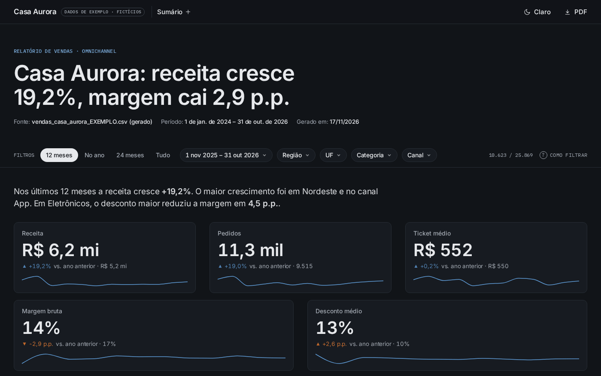
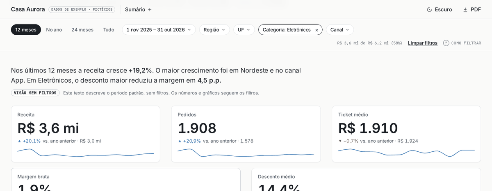
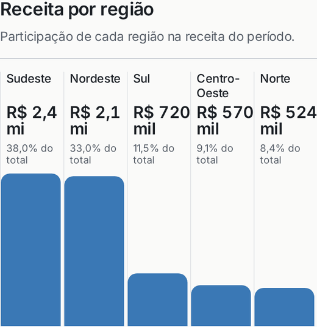
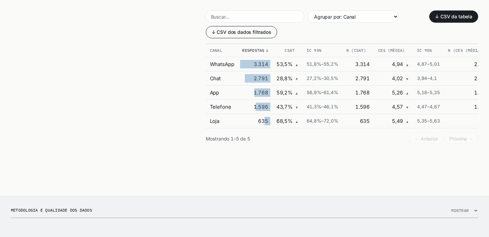
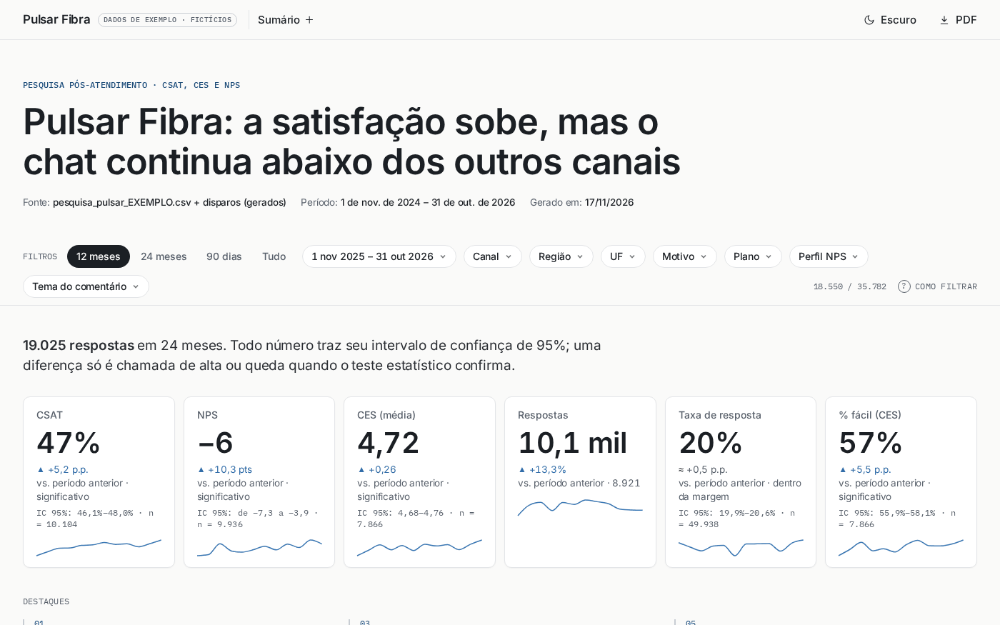
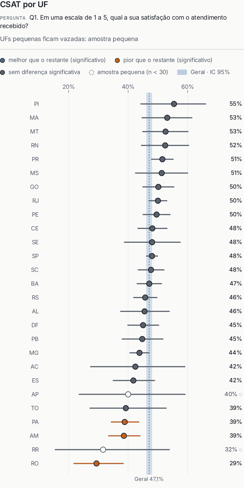
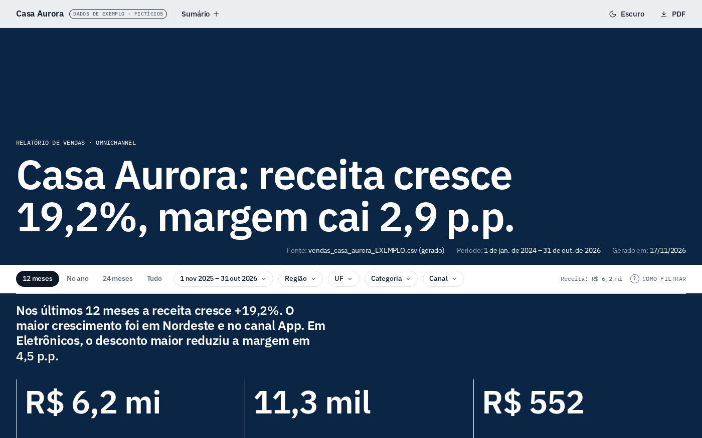
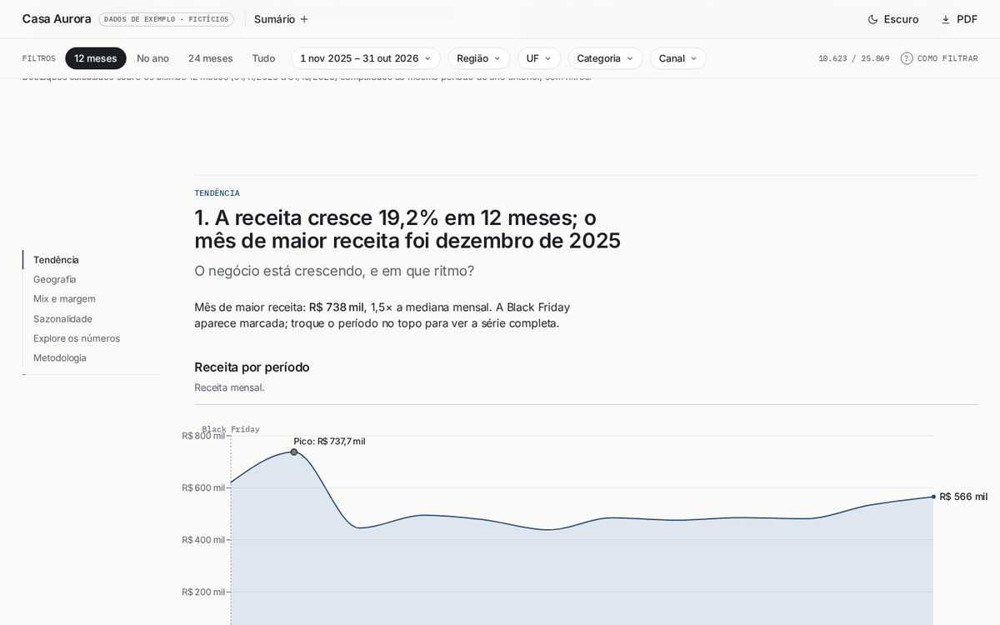
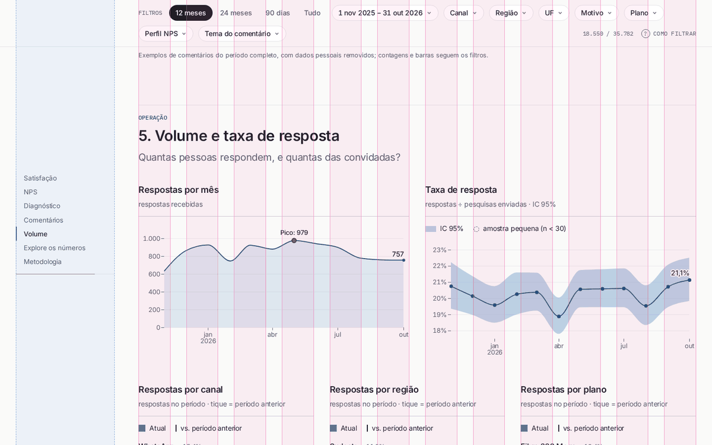

<div align="center">

# interactive-report

**Turn any spreadsheet or dataset into an editorial, interactive, single-file HTML report.**  
An Agent Skill & Python toolkit for telling a clear story with data — not building yet another dashboard.

[English](README.md) · [Português (BR)](README.pt-BR.md)

[](LICENSE)
[](SKILL.md)
[](#what-it-does)
[](#what-it-does)

</div>

---

> **Why this exists:** Dashboards (Looker, Power BI, Data Studio) are built for monitoring, not for explaining a finding. **interactive-report** pairs an AI coding agent (`SKILL.md`) with a deterministic Python + d3 / Observable Plot kit to produce a **self-contained `.html` file** that opens offline with a double click, cross-filters every chart, and reads like an edited publication (FT / The Economist / Our World in Data).

<!--
  =============================================================================
  DEMO SLOT 1 — HERO SHOWCASE (PRIMARY VISUAL)
  Recommended for the upcoming visual refresh:
  - 16:10 or 16:9 high-DPI hero screenshot (1440×900) in light mode, or an
    annotated GIF/MP4 showing cross-filtering + KPI count-up + theme switch.
  - Current asset: docs/vendas-hero-claro.png
  =============================================================================
-->
<p align="center">
  
</p>

<!--
  =============================================================================
  DEMO SLOT 2 — DARK MODE + MOBILE RESPONSIVE SIDE-BY-SIDE
  Recommended for the upcoming visual refresh:
  - Paired dark-mode desktop capture + 390px mobile capture on a clean backdrop.
  - Current assets: docs/vendas-hero-escuro.png, docs/vendas-mobile.png
  =============================================================================
-->
<p align="center">
  
  &nbsp;
  
</p>

---

## Table of Contents

- [Install as an AI Agent Skill](#install-as-an-ai-agent-skill)
- [How It Works](#how-it-works)
- [What It Does](#what-it-does)
- [Interactive Demo & UX Details](#interactive-demo--ux-details)
- [CX & Survey Analytics (CSAT, CES, NPS)](#cx--survey-analytics-csat-ces-nps)
- [Themes & Customization](#themes--customization)
- [Layout Grid](#layout-grid)
- [Standalone Quick Start (CLI / Python)](#standalone-quick-start-cli--python)
- [Project Structure](#project-structure)
- [Limitations & Privacy](#limitations--privacy)
- [License](#license)

---

## Install as an AI Agent Skill

This repository is a drop-in **Agent Skill** following the open [`SKILL.md`](SKILL.md) standard (compatible with **Claude Code**, **Cursor**, **Codex**, **Antigravity**, and other skill-enabled coding agents).

### Option 1 — via `skills` CLI (recommended)

```bash
npx skills add jpmacieldasilva/interactive-report
```

### Option 2 — Clone directly into your agent's skills folder

```bash
# Claude Code
git clone https://github.com/jpmacieldasilva/interactive-report.git ~/.claude/skills/interactive-report

# Cursor
git clone https://github.com/jpmacieldasilva/interactive-report.git ~/.cursor/skills/interactive-report
```

Then install the Python dependencies once:

```bash
pip install -r requirements.txt
python3 -m playwright install chromium
```

### Triggering the skill

Point your agent to any CSV, XLSX, JSON, Parquet, or SQLite file and ask:

> *"Build an interactive HTML report from `sales_2025.xlsx` for the commercial leadership team."*

The agent will automatically run **Step 0 (Context & Proposal)** before writing any HTML.

---

## How It Works

```text
  Your Data (CSV / XLSX / Parquet / SQLite)
        │
        ▼
  0. Context & Proposal ──► Asks goal, audience, key questions → proposes filters, sections & theme → waits for approval
        │
        ▼
  1. Profile & Clean    ──► profile.py inspects schema, dates, nulls, outliers & logs conservative cleaning
        │
        ▼
  2. Model & Narrative  ──► pandas pre-aggregates fact table & computes exact numbers/highlights (zero hallucinated stats)
        │
        ▼
  3. Build Single HTML  ──► build.py validates spec, checks WCAG contrast, inlines d3 + Plot + fonts + data → report.html
        │
        ▼
  4. Automated QA       ──► verify.py opens Chromium (1440 / 1280 / 1024 / 390 px, light & dark), tests clicks/filters & captures screenshots
```

### Step 0 — Mandatory Context Pass

Before building anything, the agent asks only what cannot be inferred from the data:
- **Goal**: what decision the report supports;
- **Audience**: who reads it (executives, ops team, external client) and their technical level;
- **Key points**: hypotheses or specific questions to answer;
- **Period & scope**: time window, comparison baseline, and business rules.

It profiles the dataset and presents a short **proposal** (filters, language & tone, section order with the question each answers, KPIs, CX mapping for surveys, theme, and assumptions). Nothing is built until you approve (or say *"go ahead"* to accept the defaults).

```python
spec["contexto"] = {
    "objetivo": "Decide where to invest and where to cut discounts next quarter",
    "publico": "Commercial leadership; fast, non-technical read",
    "pontos_chave": ["Growth by region", "Margin lost to discounting"],
    "linguagem": {"idioma": "en-US", "tom": "direct", "nivel": "executive"},
    "periodo": "Last 12 months vs. previous 12 months",
    "suposicoes": ["Cancelled orders are excluded"],
    "exibir": False,   # True adds a discreet "About this report" column to the footer
}
```

---

## What It Does

- **Editorial data visualization.** Headlines state the finding. Highlights are computed in Python, KPIs include deltas and sparklines, and each section answers one question. Built around Tufte, Few, and Cleveland principles: direct labels, zero-baseline bars, no cluttered pies, no 3D, no dual axes.
- **Full cross-filtering.** Clicking any bar, segment, dot, heatmap cell, or comment theme filters the entire report (`Shift` + click adds to the selection). Includes date presets, custom date ranges, searchable dropdowns (selected value shown inline on desktop with a clear `×`, and as chips on mobile), a live scope counter in the report's unit, and a searchable/sortable table with CSV export.
- **Static prose, live numbers.** Summaries, highlights, and numeric headlines are computed in Python for the default view and never rewritten by client-side heuristics. When a filter is active, a discreet *"Unfiltered view"* badge appears next to static prose while KPIs and charts update live.
- **Subtle micro-interactions.** Short entrance fades, growing bars on scroll, animated KPI count-ups on filter changes, collapsible sticky header, and a scroll-synced chapter menu. Configurable speed with full `prefers-reduced-motion` support.
- **Built-in reading rules.**
  - **Single time grain (`time_grain`)** enforced across all time charts, KPIs, and tables (the build fails on mismatches unless `grainOverride` is set).
  - **Verbatim survey questions** — always displayed in full, never truncated with ellipses.
  - **Literal copy** — no metaphors or editorialized fluff.
  - **Empty-state handling** — empty charts/KPIs are omitted at build time with a warning; filter-emptied charts collapse cleanly in the browser.
  - **Honest methodology** — collapsed at the end of the report by default, expanded automatically in print/PDF.
- **One portable file.** d3, Observable Plot, fonts (WOFF2), and logo are inlined. Works completely offline with light/dark mode, responsive layout, and print-ready PDF CSS.
- **Accessible by default.** Keyboard filtering preserves focus after redraws, `aria-live` announces filter changes, `Esc` returns focus to dropdowns, charts expose accessible labels, sortable table headers use `aria-sort`, text contrast is validated against WCAG 4.5:1 (light, dark, and colored heroes), and mobile tap targets are ≥ 44 px.
- **Automated QA (`verify.py`).** Headless Chromium verifies zero console errors, chart rendering, cross-filter clicks, table search/sort, dark mode, no horizontal overflow on mobile, label overlap/clipping, contrast, focus/announcements, and captures screenshots across `1440`, `1280`, `1024`, and `390` px.

---

## Interactive Demo & UX Details

<!--
  =============================================================================
  DEMO SLOT 3 — INTERACTIVE CROSS-FILTERING & UX DETAILS
  Recommended for the upcoming visual refresh:
  - Left: Cross-filter active state (or short GIF clicking a bar → KPIs & charts updating).
  - Right: Mobile chart layout with direct labels above bars.
  - Current assets: docs/vendas-filtro-visao-sem-filtros.png, docs/vendas-mobile-colunas.png
  =============================================================================
-->
<p align="center">
  
  &nbsp;
  
</p>

<!--
  =============================================================================
  DEMO SLOT 4 — READING RULES (SINGLE HELP POPOVER + COLLAPSED METHODOLOGY)
  Recommended for the upcoming visual refresh:
  - Left: Single "How to filter" (?) popover + verbatim survey question under chart title.
  - Right: Collapsed methodology block at the bottom of the report.
  - Current assets: docs/cx-ajuda-e-pergunta.png, docs/metodologia-recolhida.png
  =============================================================================
-->
<p align="center">
  
  &nbsp;
  
</p>

---

## CX & Survey Analytics (CSAT, CES, NPS)

The built-in `cx.py` module turns raw survey exports into statistically sound CX reports:

- **Automatic detection** of CSAT, CES, NPS, date, comment, and PII columns by name and scale;
- **95% confidence intervals and `n`** on every metric (Wilson for proportions, NPS variance, *t*-interval for CES mean);
- **Significance testing** via two-sided *z*-tests with Holm correction — copy only says *"up"* or *"down"* when statistically significant;
- **Small samples always shown** and explicitly flagged (*small sample*) rather than silently hidden;
- **Driver analysis**, response-rate tracking, and **offline comment themes** with heuristic PII masking (full raw comments are never embedded in the HTML).

<!--
  =============================================================================
  DEMO SLOT 5 — CX SURVEY HERO & STATISTICAL CHARTS
  Recommended for the upcoming visual refresh:
  - Full-width CX report hero + 2x2 grid of NPS significance, CSAT with CI,
    Likert distribution, and open-comment themes.
  - Current assets: docs/cx-hero.png, docs/cx-nps-por-canal.png,
    docs/cx-csat-por-uf-ic.png, docs/cx-likert-csat.png, docs/cx-temas-comentarios.png
  =============================================================================
-->
<p align="center">
  
</p>

<p align="center">
  
  &nbsp;
  
</p>

<p align="center">
  
</p>

<p align="center">
  
</p>

---

## Themes & Customization

Every visual token is controlled by a JSON theme (`TEMA.md`): layout (`clean` or `blocks`), fonts (Google Fonts inlined as WOFF2, local files, or system fonts), light/dark colors, colorblind-safe data palettes, border radius, rules, spacing, typography scale, hero style, motion speed, and brand logo. `build.py` validates WCAG contrast at build time.

| Preset | Layout | Visual Style |
|---|---|---|
| `neutro` *(default)* | `clean` | Calm & neutral: off-white canvas, grey ink scale, deep blue `#1F4E79`, Inter + IBM Plex Mono, KPI cards |
| `corporativo` | `blocks` | Navy-blue hero and KPI band, IBM Plex |
| `jornal` | `clean` | Editorial serif headings (Newsreader), warm cream canvas, crimson accent |
| `noturno` | `blocks` | Dark canvas, lime-green blocks, Space Grotesk |
| `destaque` | `blocks` | Sun-yellow hero, teal data palette, Archivo — built for presentations |

<!--
  =============================================================================
  DEMO SLOT 6 — THEME GALLERY
  Recommended for the upcoming visual refresh:
  - Side-by-side or 2x2 collage comparing neutro, corporativo, jornal, noturno,
    and destaque presets on the same dataset.
  - Current asset: docs/tema-corporativo-hero.png
  =============================================================================
-->
<p align="center">
  
</p>

Override any theme property inline in your spec or pass `--theme`:

```python
spec["theme"] = {
    "primary": "#0B5FFF",
    "accent":  "#7FB2FF",
    "font": "Inter",
    "heading": "Fraunces",       # Google Fonts → automatically inlined as woff2
    "logo": "logo.svg",
    "brand": "Acme",
    "hero": {"style": "plain"},
    "motion": {"speed": 0.8},
}
```

Test a theme configuration without building a full report:

```bash
python tema.py jornal
```

---

## Layout Grid

Reports follow a unified two-zone, **12-column grid** (32 px fixed gutter) where every chart occupies **100% (`full`), 50% (`half`), or 33% (`third`)**:

- **Full-width header zone**: title, metadata, sticky filter bar, summary, KPIs, and highlights span the full page width.
- **Content zone + reserved chapter rail**: sections, charts, table, and methodology sit in a fixed max-width column next to a reserved left rail where the chapter menu fades in as you scroll past the header (zero layout shift).
- **Row integrity**: every row uses a single width (`1 full`, `2 halves`, or `3 thirds`). Incomplete rows are widened automatically with a build warning, side-by-side chart titles share height so axes align, and `verify.py` audits alignment at `1440`, `1280`, `1024`, and `390` px.

```python
{"type": "bars", "dim": "canal", "measure": "receita", "width": "half"}  # full (default) | half | third
```

<!--
  =============================================================================
  DEMO SLOT 7 — SCROLL CHOREOGRAPHY & 12-COLUMN LAYOUT GRID
  Recommended for the upcoming visual refresh:
  - Top vs. scrolled sticky-filter + chapter rail comparison, plus the 12-column
    grid overlay.
  - Current assets: docs/vendas-topo.png, docs/vendas-rolado-menu.png,
    docs/grid-12-colunas.png
  =============================================================================
-->
<p align="center">
  
  &nbsp;
  
</p>

<p align="center">
  
</p>

---

## Standalone Quick Start (CLI / Python)

You can also run the toolkit directly without an AI agent:

```bash
git clone https://github.com/jpmacieldasilva/interactive-report.git
cd interactive-report
python3 -m venv .venv && source .venv/bin/activate
pip install -r requirements.txt
python -m playwright install chromium

# Run the included examples (fictional CSVs are generated on first run)
python exemplos/vendas/preparar.py               # → exemplos/vendas/relatorio.html
python exemplos/vendas/preparar.py corporativo   # → exemplos/vendas/relatorio-corporativo.html
python exemplos/cx/preparar.py                   # → exemplos/cx/relatorio.html

# Run automated QA and capture screenshots
python verify.py exemplos/cx/relatorio.html --out /tmp/captures
```

Pre-built HTML examples are already committed under `exemplos/` — open them directly in your browser.

### With your own data

1. **Profile**: `python profile.py data.xlsx --out profile.json --clean-out clean.parquet` (supports CSV, XLSX, JSON, Parquet, SQLite).
2. **Spec**: Compute measures (rates as ratio of sums), pre-aggregate, and compute highlights in Python (copy `exemplos/vendas/preparar.py` or `exemplos/cx/preparar.py`).
3. **Build**: `python build.py spec.json report.html --theme jornal` (or `rb.build(spec, "report.html", theme="jornal")`).
4. **Verify**: `python verify.py report.html --pdf`.

Importing modules by path (since `profile.py` shares a name with Python's stdlib `profile`):

```python
import importlib.util, os, sys

KIT = os.environ.get("INTERACTIVE_REPORT_KIT", "/path/to/interactive-report")

def kit(name):
    s = importlib.util.spec_from_file_location("kit_" + name, os.path.join(KIT, f"{name}.py"))
    m = importlib.util.module_from_spec(s)
    sys.modules["kit_" + name] = m
    s.loader.exec_module(m)
    return m

rp, rb, cx = kit("profile"), kit("build"), kit("cx")
```

---

## Project Structure

```text
interactive-report/
├── SKILL.md            # Agent Skill instructions & report spec reference
├── profile.py          # Universal loader, conservative cleaner & data profiler
├── build.py            # Spec validator, columnar encoder & single-file HTML builder
├── verify.py           # Headless Chromium QA suite (layout, a11y, filters, screenshots, PDF)
├── cx.py               # Survey analytics engine (CSAT/CES/NPS, CIs, z-tests, drivers, themes)
├── tema.py             # Theme resolver & WCAG contrast checker
├── template.html       # Self-contained report shell (d3 + Observable Plot + cross-filter engine)
├── TEMA.md             # Full theme documentation
├── temas/              # Built-in theme presets (neutro, corporativo, jornal, noturno, destaque)
├── vendor/             # Pinned d3, Observable Plot & cached OFL fonts for offline builds
├── exemplos/           # Worked sales & CX survey examples (fictional datasets)
└── docs/               # Screenshots and visual demo assets
```

---

## Limitations & Privacy

- **Client-side data:** Everything embedded in the HTML goes to the browser. Aggregate or strip PII and secrets before building (in surveys, raw full comments are never embedded).
- **Scale:** Browser cross-filtering stays snappy up to ~150k–200k fact rows. Above that, aggregate to a coarser grain (e.g., day → week).
- **Static highlights:** Editorial highlights describe the default unfiltered view; KPIs and charts update dynamically.
- **Comment themes & PII masking:** Offline themes assign one theme per comment based on distinctive terms, and PII masking is heuristic — always review quotes before sharing externally.
- **Statistical assumptions:** Drivers measure association, not causation; significance tests assume independent responses.
- **Google Fonts:** Require internet access only on the first build (cached under `vendor/fonts-cache/`).

---

## License

Code licensed under [MIT](LICENSE) © 2026 João Paulo da Silva.  
Bundled third-party assets — d3 & Observable Plot (ISC) and Geist, IBM Plex, Inter, JetBrains Mono, Montserrat, Newsreader, Space Grotesk (SIL OFL 1.1) — retain their respective licenses. See [NOTICE.md](NOTICE.md). All sample datasets in `exemplos/` are **fictional**.
