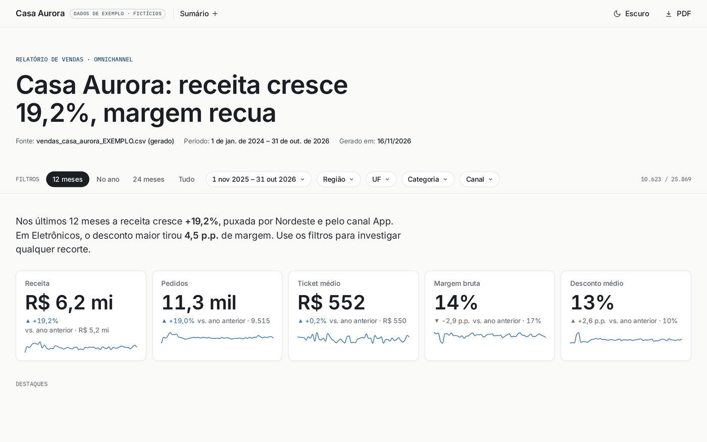
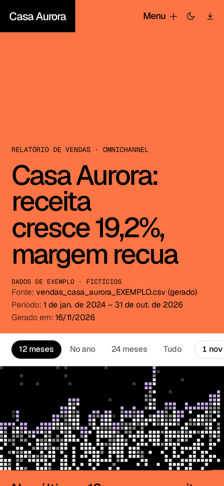
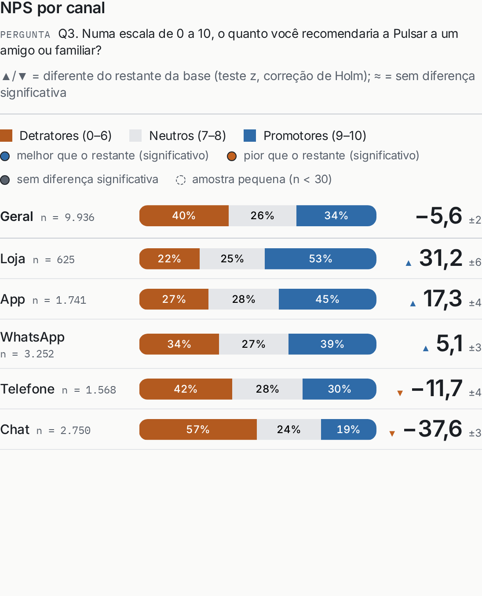
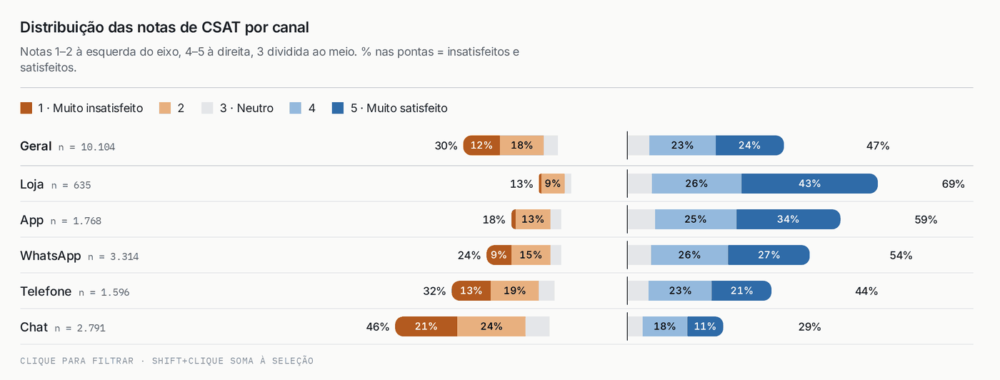
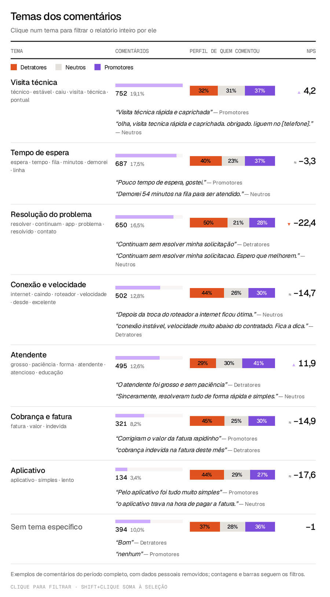

# relatorio-html

**Relatórios editoriais e interativos em um único arquivo HTML, a partir de qualquer planilha ou base de dados.** É uma alternativa ao Looker / Data Studio para quando você quer contar uma história com os dados, e não montar mais um painel.

Você descreve o relatório em Python (um *spec*). O kit valida o spec, embute os dados, as bibliotecas e as fontes, e gera um `.html` que abre offline com dois cliques. Depois um teste automático (Playwright) confere se tudo renderiza e responde aos filtros.



<p>
  
  
</p>

## O que faz

- **Visualização editorial.** O título afirma o achado. Os destaques são calculados, os KPIs vêm com variação e minigráfico, e cada seção responde a uma pergunta. Seguem as regras de Tufte, Few e Cleveland: rótulos diretos, barras a partir do zero, nada de pizza com muitas fatias, nada de 3D, nada de dois eixos.
- **Filtro cruzado em tudo.** Clicar numa barra, segmento, ponto, célula ou tema filtra o relatório inteiro (Shift soma à seleção). Há também presets de datas, intervalo livre, dropdowns com busca, chips de filtro ativo e uma tabela com busca, ordenação e exportação CSV.
- **Micro-interações discretas.** Título e cartões de KPI entram com um fade curto. As barras crescem quando entram na tela, os números dos KPIs contam até o valor e se animam a cada filtro, e as linhas se desenham. O cabeçalho se esconde ao rolar e o sumário lateral marca o capítulo ativo. A velocidade é configurável, e tudo respeita `prefers-reduced-motion`.
- **Pesquisas de satisfação (CSAT, CES, NPS)** com estatística honesta:
  - o kit detecta as colunas de nota pelo nome e pela escala;
  - todo número traz intervalo de confiança de 95% e n (Wilson, variância do NPS, t);
  - diferenças passam por teste z com correção de Holm, e o texto só diz "subiu" ou "caiu" quando o teste confirma;
  - grupos pequenos aparecem sempre, marcados como *amostra pequena*;
  - há análise de impacto (drivers), taxa de resposta e temas dos comentários agrupados offline, com dados pessoais mascarados.
- **Temas configuráveis.** Fontes (Google Fonts embutidas, arquivo local ou fonte do sistema), cor principal, paleta de dados, cantos, fios, espaçamento, escala tipográfica, hero, movimento e logo. Dois layouts (`clean` e `blocks`) e cinco presets. O build checa o contraste (WCAG, 4,5:1).
- **Um arquivo só.** d3 e Observable Plot vão embutidos, assim como as fontes e o logo. Tem modo claro e escuro, layout responsivo e um PDF pronto para impressão.
- **QA automático.** `verify.py` abre o relatório no Chromium e checa erros no console, se cada gráfico renderizou, cliques e filtros, a tabela, o modo escuro e a ausência de rolagem lateral no celular. Também tira os screenshots.

### Pesquisas de satisfação


<p>
  
  
</p>





### Temas

O padrão é o **Neutro**: fundo off-white, tinta em escala de cinzas e um azul profundo como cor principal. A paleta de dados é segura para daltonismo. As fontes são Inter + IBM Plex Mono. O cabeçalho é simples, os KPIs vêm em cartões e o movimento é discreto. Para mudar, basta escolher outro preset ou sobrescrever qualquer valor.

| Preset | Layout | Estilo |
|---|---|---|
| `neutro` (padrão) | `clean` | Neutro e calmo: cinzas, azul `#1F4E79`, Inter, cartões de KPI |
| `corporativo` | `blocks` | Herói e faixa de KPIs em azul-marinho, IBM Plex |
| `jornal` | `clean` | Títulos serifados (Newsreader), fundo creme, vermelho como cor principal |
| `noturno` | `blocks` | Escuro, blocos verde-limão, Space Grotesk |
| `destaque` | `blocks` | Herói em amarelo-sol, dados em azul-petróleo, Archivo; para apresentações |

O mesmo relatório de vendas no preset `corporativo`:


## Como funciona

1. **Contextualização (passo 0, obrigatório).** Antes de gerar qualquer coisa, o agente pergunta só o que não dá para inferir:
   - o **objetivo**, isto é, que decisão o relatório vai apoiar;
   - o **público** (diretoria, time, cliente) e o nível técnico;
   - os **pontos-chave** ou hipóteses que a pessoa quer ver;
   - o **período** e o recorte.

   Em seguida, roda o perfil dos dados e devolve uma **proposta curta** para aprovação: filtros (colunas do cross-filter), linguagem e tom, seções na ordem de leitura (com a pergunta que cada uma responde e o gráfico previsto), KPIs, métricas de CX quando for pesquisa (CSAT, CES, NPS), tema e suposições. Nada é construído antes do "ok". Quem preferir pode dizer "segue", e o agente usa a proposta e registra as suposições.
2. **Modelagem.** As respostas ficam em `spec["contexto"]` e orientam o resto. O título responde ao objetivo, o texto segue o público e cada ponto-chave vira um destaque ou uma seção. Com `"exibir": true`, objetivo, público e pontos-chave aparecem numa coluna discreta no rodapé.
3. **Narrativa e build.** Os destaques são calculados em pandas e o `build.py` gera um único HTML.
4. **Verificação.** O `verify.py` testa o relatório num Chromium headless e tira os screenshots antes da entrega.

```python
spec["contexto"] = {
    "objetivo": "Decidir onde investir e onde cortar desconto no próximo trimestre",
    "publico": "Diretoria comercial; leitura rápida, pouco técnica",
    "pontos_chave": ["Crescimento por região", "Margem perdida com desconto"],
    "linguagem": {"idioma": "pt-BR", "tom": "direto", "nivel": "leigo"},
    "periodo": "Últimos 12 meses vs. os 12 anteriores",
    "suposicoes": ["Pedidos cancelados ficam fora"],
    "exibir": False,   # True = coluna "Sobre este relatório" no rodapé
}
```

## Começando

```bash
git clone https://github.com/jpmacieldasilva/relatorio-html.git
cd relatorio-html
python3 -m venv .venv && source .venv/bin/activate
pip install -r requirements.txt
python -m playwright install chromium

# exemplos (os CSVs fictícios são gerados na primeira execução)
python exemplos/vendas/preparar.py               # → exemplos/vendas/relatorio.html
python exemplos/vendas/preparar.py corporativo   # → relatorio-corporativo.html
python exemplos/cx/preparar.py                   # → exemplos/cx/relatorio.html
python verify.py exemplos/cx/relatorio.html --out /tmp/capturas
```

Os HTMLs já gerados estão em `exemplos/`. Basta abrir no navegador.

### Com os seus dados

0. **Contexto.** Defina objetivo, público, pontos-chave e linguagem, e guarde em `spec["contexto"]` (veja *Como funciona*).
1. **Perfil.** `python profile.py dados.xlsx --out perfil.json --clean-out limpo.parquet` lê CSV, XLSX, JSON, Parquet e SQLite e faz uma limpeza conservadora. O resultado mostra papéis das colunas, nulos, datas, outliers e alertas.
2. **Spec.** Em Python, monte as medidas (taxas são sempre razão de somas), pré-agregue, calcule os destaques com pandas e escreva o spec. Copie a estrutura de `exemplos/vendas/preparar.py`. Para pesquisas, use `exemplos/cx/preparar.py` e `cx.py`.
3. **Build.** `build.build(spec, "relatorio.html", theme="jornal")`, ou pela linha de comando: `python build.py spec.json relatorio.html --theme corporativo`.
4. **Verificação.** `python verify.py relatorio.html --pdf`. Não entregue com falha.

Para importar os módulos por caminho (o nome `profile` colide com a stdlib):

```python
import importlib.util, os, sys
KIT = os.environ.get("RELATORIO_KIT", "/caminho/para/relatorio-html")
def kit(name):
    s = importlib.util.spec_from_file_location("kit_" + name, os.path.join(KIT, f"{name}.py"))
    m = importlib.util.module_from_spec(s); sys.modules["kit_" + name] = m; s.loader.exec_module(m); return m
rp, rb, cx = kit("profile"), kit("build"), kit("cx")
```

## Como skill de agente de IA

A pasta inteira é uma *skill* no formato `SKILL.md` (Cursor, Claude Code e afins). Copie ou clone o repositório para a pasta de skills do agente, por exemplo `~/.cursor/skills/relatorio-html/` ou `~/.claude/skills/relatorio-html/`. O agente passa a:

1. contextualizar: perguntar objetivo, público, pontos-chave e período, perfilar os dados e propor filtros, linguagem, seções, KPIs (e o mapeamento das colunas quando for pesquisa) e tema. Depois, esperar a aprovação;
2. guardar o que foi aprovado em `spec["contexto"]`;
3. modelar e calcular a narrativa em pandas, sem inventar números nem direções;
4. gerar o relatório;
5. rodar `verify.py` e revisar os screenshots antes de entregar.

Os caminhos no `SKILL.md` são relativos à pasta da skill. `RELATORIO_KIT` permite apontar para outra localização.

## Configurando o tema

Pelo spec (`spec["theme"]`) ou por `--theme`, você passa um preset, um arquivo JSON ou ajustes inline mesclados sobre o padrão:

```python
spec["theme"] = {
    "primary": "#0B5FFF",          # blocos do hero e da faixa de KPIs
    "accent":  "#7FB2FF",          # cor dos dados
    "font": "Inter", "heading": "Fraunces",   # Google Fonts → embutidas como woff2
    "logo": "logo.svg", "brand": "Acme",
    "hero": {"style": "plain"},    # sem bloco de cor
    "motion": {"speed": 0.8},
}
```

Um tema completo (`temas/neutro.json`) define `layout` (`clean` ou `blocks`), `fonts`, `colors` (light/dark), `palette` (categórica, sequencial, divergente, positivo/negativo), `shape`, `space`, `type`, `hero`, `motion` e `brand`. Veja [`TEMA.md`](TEMA.md). Para testar um tema sem gerar relatório: `python tema.py jornal`.

## Limitações

- **Todos os dados vão para o navegador.** Agregue ou remova dados pessoais e segredos antes. Nas pesquisas, o texto completo dos comentários não é embutido.
- **Volume.** O filtro no navegador é confortável até cerca de 150–200 mil linhas na tabela fato. Acima disso, agregue mais (por exemplo, dia → semana).
- **Destaques.** Os textos de destaque são estáticos e descrevem a visão padrão; KPIs e gráficos são vivos.
- **Temas dos comentários** são aproximados: um tema por comentário, nomes a partir dos termos mais característicos. Revise e renomeie.
- **Mascaramento de dados pessoais** é heurístico. Revise as citações antes de compartilhar.
- **Drivers** mostram associação, não causa. Os testes assumem respostas independentes.
- **Fontes do Google** precisam de internet só no primeiro build (ficam em cache em `vendor/fonts-cache/`).

## Licenças

Código sob [MIT](LICENSE) © 2026 João Paulo da Silva. d3 e Observable Plot (ISC) e as fontes Geist, IBM Plex, Inter, JetBrains Mono, Montserrat, Newsreader e Space Grotesk (SIL OFL 1.1) vão embutidos com suas próprias licenças. Veja [NOTICE.md](NOTICE.md). Os dados de exemplo são **fictícios**.

---

## English

**relatorio-html** turns any dataset (CSV, XLSX, JSON, Parquet, SQLite) into an editorial, interactive, **single-file HTML report**:

- story-first layout and cross-filtering charts (d3 + Observable Plot);
- micro-interactions, light/dark mode, print/PDF;
- a searchable table with CSV export;
- automated Playwright QA.

It includes a **survey module** for CSAT, CES and NPS:

- automatic column detection;
- 95% confidence intervals on every number;
- z-tests with Holm correction, so wording is derived from significance;
- small groups always shown and flagged;
- driver analysis, response rate, and offline comment themes with PII masking.

The look is driven by **JSON themes**: layout (`clean` or `blocks`), fonts (Google Fonts inlined, local files or system), colors, palette, radius, spacing, type scale, hero, motion and logo. Contrast is checked at build time.

The default theme, **Neutro**, is calm and neutral:

- off-white page, grey ink scale and one deep-blue primary;
- colorblind-safe data palette;
- Inter + IBM Plex Mono;
- plain header, KPI cards and subtle fade/grow motion.

Other presets: `corporativo` (navy block hero), `jornal` (serif, newspaper), `noturno` (dark, lime) and `destaque` (sun-yellow blocks, for presentations).

How it works: **step 0 is a mandatory context pass.** The agent asks only what it can't infer: the goal (which decision the report supports), the audience and its technical level, the key points or hypotheses, and the period. It then profiles the data and sends a short proposal: filters, language and tone, sections (each with its question and chart), KPIs, CX metrics for surveys, theme and assumptions. It builds nothing until the user approves; "go ahead" skips the round and records the assumptions. The answers live in `spec["contexto"]` and steer the headline, the copy and the section order. `"exibir": true` shows them in a discreet footer column. After that come the pandas narrative, `build.py` and `verify.py`.

Quick start: `pip install -r requirements.txt && python -m playwright install chromium`, then `python exemplos/vendas/preparar.py` and `python verify.py exemplos/vendas/relatorio.html`. The folder is also a drop-in **AI agent skill** (`SKILL.md`, paths relative to the skill folder). Docs are mostly in Portuguese (pt-BR). Code comments and `SKILL.md` are in English. MIT licensed; bundled third-party licenses are listed in `NOTICE.md`.
