<div align="center">

# interactive-report

**Transforme qualquer planilha ou base de dados em um relatório editorial, interativo e em um único arquivo HTML.**  
Uma Agent Skill + kit Python para contar uma história clara com os dados — e não montar mais um painel.

[English](README.md) · [Português (BR)](README.pt-BR.md)

[](LICENSE)
[](SKILL.md)
[](#o-que-faz)
[](#o-que-faz)

</div>

---

> **Por que existe:** Painéis (Looker, Power BI, Data Studio) servem para monitoramento contínuo, não para explicar um achado. O **interactive-report** combina uma skill de agente de IA (`SKILL.md`) com um kit determinístico em Python + d3 / Observable Plot para gerar um **`.html` autossuficiente** que abre offline com dois cliques, tem filtro cruzado em tudo e se lê como uma reportagem de dados (FT / The Economist / Our World in Data).

<!--
  =============================================================================
  SLOT DE DEMO 1 — HERO PRINCIPAL
  Sugestão para a refação visual:
  - Captura em alta resolução (1440×900) no tema padrão, ou GIF/MP4 curto
    mostrando filtro cruzado + contagem animada dos KPIs + troca de tema.
  - Asset atual: docs/vendas-hero-claro.png
  =============================================================================
-->
<p align="center">
  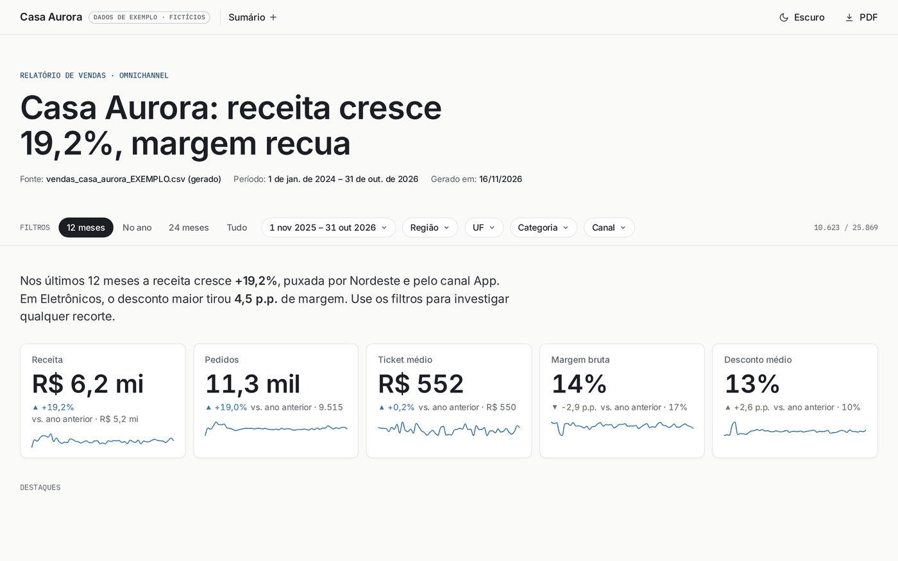
</p>

<!--
  =============================================================================
  SLOT DE DEMO 2 — MODO ESCURO + MOBILE LADO A LADO
  Sugestão para a refação visual:
  - Desktop em modo escuro + visualização mobile (390 px) em destaque.
  - Assets atuais: docs/vendas-hero-escuro.png, docs/vendas-mobile.png
  =============================================================================
-->
<p align="center">
  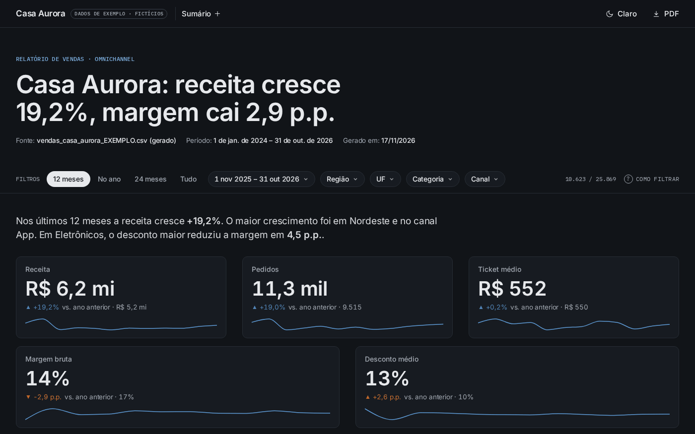
  &nbsp;
  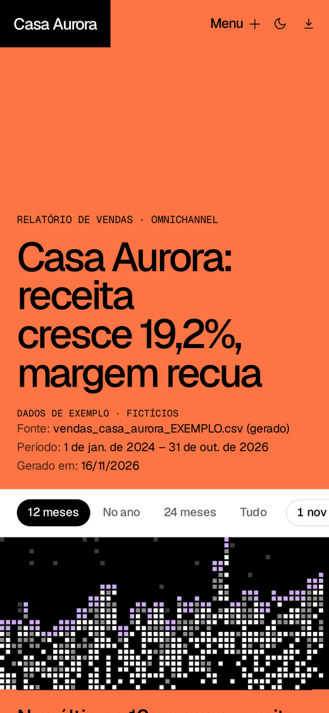
</p>

---

## Sumário

- [Instalar como Skill de Agente de IA](#instalar-como-skill-de-agente-de-ia)
- [Como funciona](#como-funciona)
- [O que faz](#o-que-faz)
- [Demonstração de Interação e UX](#demonstração-de-interação-e-ux)
- [Pesquisas de Satisfação (CSAT, CES, NPS)](#pesquisas-de-satisfação-csat-ces-nps)
- [Temas e Personalização](#temas-e-personalização)
- [Grid de Layout](#grid-de-layout)
- [Uso Direto via CLI / Python](#uso-direto-via-cli--python)
- [Estrutura do Repositório](#estrutura-do-repositório)
- [Limitações e Privacidade](#limitações-e-privacidade)
- [Licenças](#licenças)

---

## Instalar como Skill de Agente de IA

O repositório inteiro é uma **Agent Skill** no padrão aberto [`SKILL.md`](SKILL.md) (compatível com **Claude Code**, **Cursor**, **Codex**, **Antigravity** e outros agentes compatíveis).

### Opção 1 — via CLI `skills` (recomendado)

```bash
npx skills add jpmacieldasilva/interactive-report
```

### Opção 2 — Clonar direto na pasta de skills do agente

```bash
# Claude Code
git clone https://github.com/jpmacieldasilva/interactive-report.git ~/.claude/skills/interactive-report

# Cursor
git clone https://github.com/jpmacieldasilva/interactive-report.git ~/.cursor/skills/interactive-report
```

Instale as dependências Python uma única vez:

```bash
pip install -r requirements.txt
python3 -m playwright install chromium
```

### Como acionar

Aponte seu agente para qualquer arquivo CSV, XLSX, JSON, Parquet ou SQLite e peça:

> *"Crie um relatório interativo em HTML a partir de `vendas_2025.xlsx` para a diretoria comercial."*

O agente executa automaticamente o **Passo 0 (Contextualização e Proposta)** antes de construir qualquer HTML.

---

## Como funciona

```text
  Seus Dados (CSV / XLSX / Parquet / SQLite)
        │
        ▼
  0. Contextualização   ──► Pergunta objetivo, público e pontos-chave → propõe filtros, seções e tema → aguarda aprovação
        │
        ▼
  1. Perfil e Limpeza   ──► profile.py inspeciona colunas, datas, nulos, outliers e registra limpeza conservadora
        │
        ▼
  2. Modelagem e Texto  ──► pandas pré-agrega a tabela fato e calcula números e destaques reais (sem inventar dados)
        │
        ▼
  3. Build HTML Único   ──► build.py valida o spec, checa contraste WCAG e embute d3 + Plot + fontes + dados → relatorio.html
        │
        ▼
  4. QA Automático      ──► verify.py abre no Chromium (1440 / 1280 / 1024 / 390 px, claro/escuro), testa filtros e gera capturas
```

### Passo 0 — Contextualização obrigatória

Antes de gerar qualquer coisa, o agente pergunta só o que não dá para inferir dos dados:
- **Objetivo**: que decisão o relatório vai apoiar;
- **Público**: quem lê (diretoria, time, cliente) e o nível técnico;
- **Pontos-chave**: hipóteses ou perguntas específicas que a pessoa quer responder;
- **Período e recorte**: janela de tempo, comparação e regras de negócio.

Em seguida, roda o perfil dos dados e devolve uma **proposta curta** para aprovação (filtros, linguagem e tom, ordem das seções com a pergunta de cada uma, KPIs, mapeamento de CX quando for pesquisa, tema e suposições). Nada é construído antes do *"ok"* (quem preferir pode dizer *"segue"* e o agente registra as suposições).

```python
spec["contexto"] = {
    "objetivo": "Decidir onde investir e onde cortar desconto no próximo trimestre",
    "publico": "Diretoria comercial; leitura rápida, pouco técnica",
    "pontos_chave": ["Crescimento por região", "Margem perdida com desconto"],
    "linguagem": {"idioma": "pt-BR", "tom": "direto", "nivel": "leigo"},
    "periodo": "Últimos 12 meses vs. os 12 anteriores",
    "suposicoes": ["Pedidos cancelados ficam fora"],
    "exibir": False,   # True = coluna discreta "Sobre este relatório" no rodapé
}
```

---

## O que faz

- **Visualização editorial.** O título afirma o achado. Os destaques são calculados em Python, os KPIs vêm com variação e minigráfico, e cada seção responde a uma pergunta. Segue as regras de Tufte, Few e Cleveland: rótulos diretos, barras a partir do zero, nada de pizza lotada, nada de 3D e nada de dois eixos.
- **Filtro cruzado em tudo.** Clicar numa barra, segmento, ponto, célula ou tema filtra o relatório inteiro (`Shift` soma à seleção). Inclui presets de datas, intervalo livre, dropdowns com busca (no desktop o valor escolhido aparece dentro do próprio dropdown com `×` para limpar; no celular, como chip), contador na unidade do relatório (*"R$ 3,6 mi de R$ 6,2 mi"*) e tabela com busca, ordenação e exportação CSV.
- **Texto fixo, números vivos.** O resumo, os destaques e os títulos com números são calculados em Python para a visão padrão e nunca são reescritos no navegador. Com um filtro ativo, aparece ao lado deles uma nota discreta *"Visão sem filtros"*, enquanto KPIs e gráficos acompanham o filtro.
- **Micro-interações discretas.** Título e cartões de KPI entram com fade curto, barras crescem ao entrar na tela, números dos KPIs se animam a cada filtro, o cabeçalho se esconde ao rolar e o sumário lateral marca o capítulo ativo. Velocidade configurável com suporte completo a `prefers-reduced-motion`.
- **Regras de leitura consistentes.**
  - **Granularidade de tempo única (`time_grain`)** em todo o relatório (o build falha se um gráfico tentar outra sem `grainOverride`).
  - **Pergunta da pesquisa completa**, exatamente como está no dado, sem resumo nem reticências.
  - **Texto literal**, sem analogias nem metáforas (*"caiu 3 pontos"*, não *"esfriou"*).
  - **Tratamento de vazios** — gráficos e KPIs sem dados são omitidos no build com aviso; no navegador, um gráfico esvaziado pelo filtro vira uma linha discreta.
  - **Metodologia honesta** no fim do relatório, recolhida por padrão (no PDF sai aberta).
- **Um arquivo só.** d3, Observable Plot, fontes (WOFF2) e logo vão embutidos. Abre offline com modo claro e escuro, layout responsivo e CSS pronto para impressão/PDF.
- **Acessível.** Navegação e filtro pelo teclado preservam o foco após o redesenho, `aria-live` anuncia o filtro, `Esc` devolve o foco ao dropdown, cabeçalhos da tabela usam `aria-sort`, contraste validado em WCAG 4,5:1 (inclusive no modo escuro e sobre hero colorido) e botões no celular com ≥ 44 px.
- **QA automático (`verify.py`).** Abre o relatório no Chromium headless em `1440`, `1280`, `1024` e `390` px (claro e escuro) e valida console limpo, renderização dos gráficos, cliques/filtros, tabela, ausência de rolagem horizontal, sobreposição de rótulos, contraste, foco e tira screenshots.

---

## Demonstração de Interação e UX

<!--
  =============================================================================
  SLOT DE DEMO 3 — FILTRO CRUZADO E DETALHES DE UX
  Sugestão para a refação visual:
  - Esquerda: Filtro ativo (ou GIF clicando em uma barra e atualizando tudo).
  - Direita: Gráfico no celular com rótulos acima das barras.
  - Assets atuais: docs/vendas-filtro-visao-sem-filtros.png, docs/vendas-mobile-colunas.png
  =============================================================================
-->
<p align="center">
  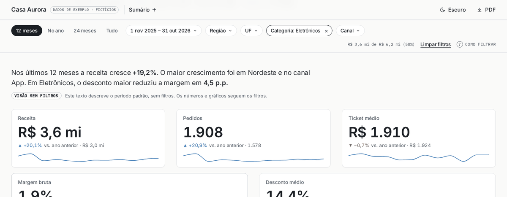
  &nbsp;
  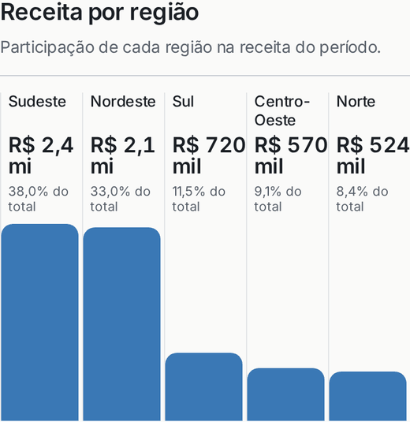
</p>

<!--
  =============================================================================
  SLOT DE DEMO 4 — REGRAS DE LEITURA (AJUDA ÚNICA + METODOLOGIA RECOLHIDA)
  Sugestão para a refação visual:
  - Esquerda: Botão único "Como filtrar" (?) na barra + pergunta literal da pesquisa.
  - Direita: Bloco de metodologia recolhido no fim do relatório.
  - Assets atuais: docs/cx-ajuda-e-pergunta.png, docs/metodologia-recolhida.png
  =============================================================================
-->
<p align="center">
  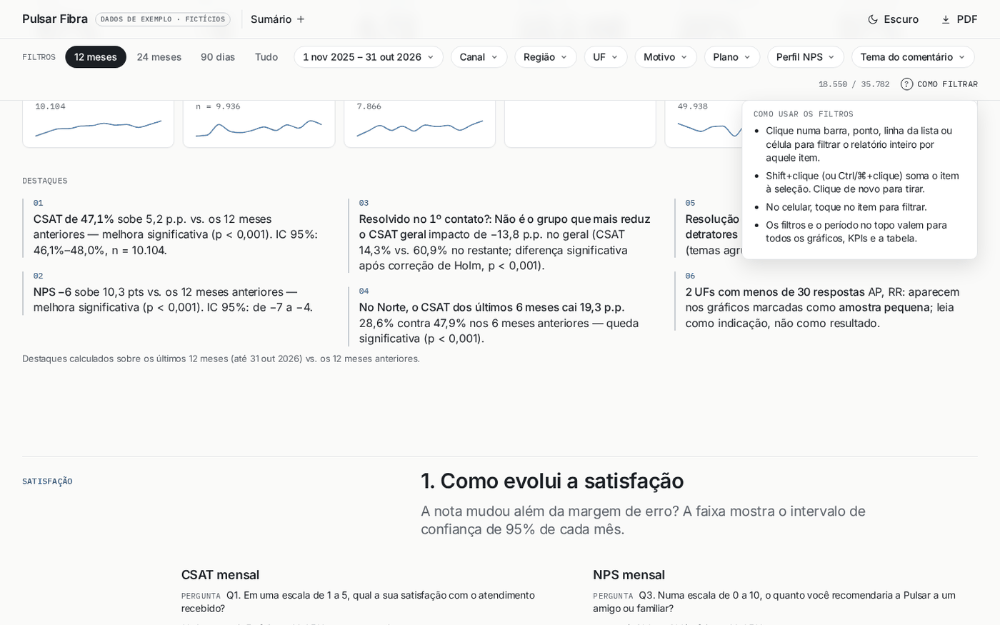
  &nbsp;
  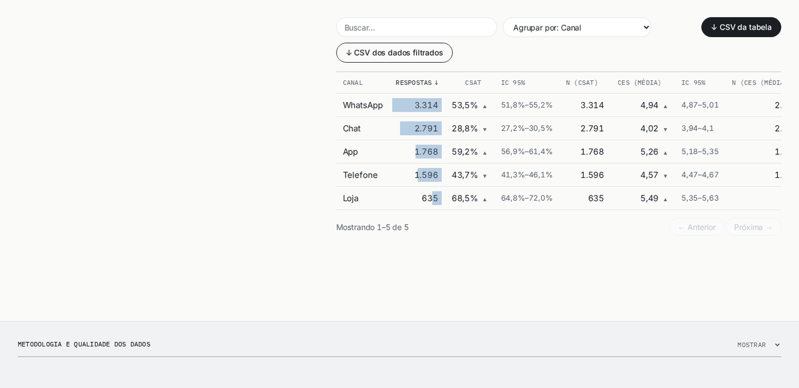
</p>

---

## Pesquisas de Satisfação (CSAT, CES, NPS)

O módulo `cx.py` transforma exportações brutas de pesquisa em relatórios estatisticamente honestos:

- **Detecção automática** das colunas de CSAT, CES, NPS, data, comentários e dados pessoais (PII);
- **Intervalo de confiança de 95% e `n`** em todo número (Wilson para proporções, variância do NPS, *t* para média do CES);
- **Testes de significância** (*z* bilateral com correção de Holm) — o texto só diz *"subiu"* ou *"caiu"* quando há significância estatística;
- **Grupos pequenos sempre visíveis**, marcados explicitamente como *amostra pequena*;
- **Análise de impacto (drivers)**, taxa de resposta e **temas de comentários agrupados offline** com mascaramento de dados pessoais (o texto completo nunca vai para o HTML).

<!--
  =============================================================================
  SLOT DE DEMO 5 — PESQUISAS DE SATISFAÇÃO (CX)
  Sugestão para a refação visual:
  - Hero do relatório de pesquisa + grade com NPS por canal, CSAT com IC,
    distribuição Likert e temas dos comentários.
  - Assets atuais: docs/cx-hero.png, docs/cx-nps-por-canal.png,
    docs/cx-csat-por-uf-ic.png, docs/cx-likert-csat.png, docs/cx-temas-comentarios.png
  =============================================================================
-->
<p align="center">
  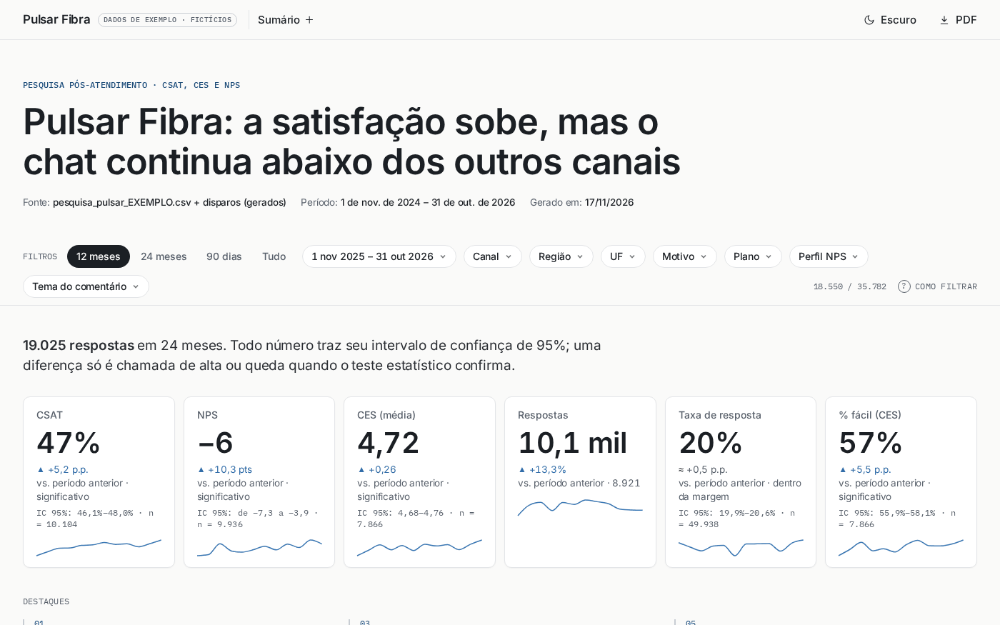
</p>

<p align="center">
  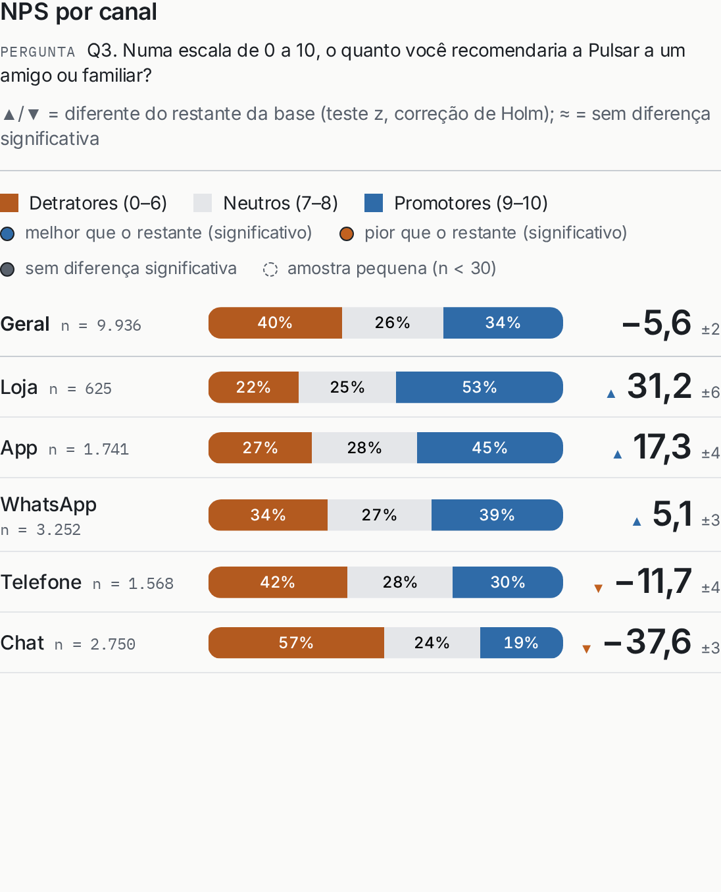
  &nbsp;
  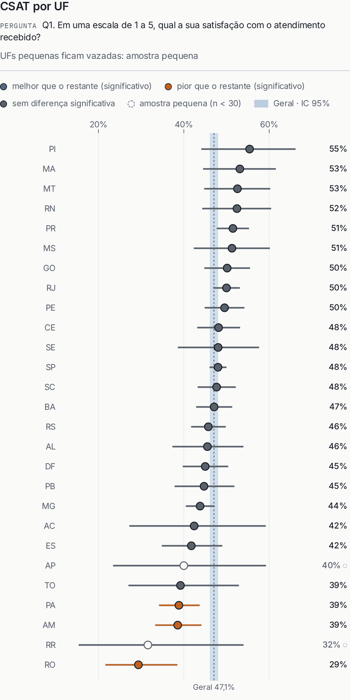
</p>

<p align="center">
  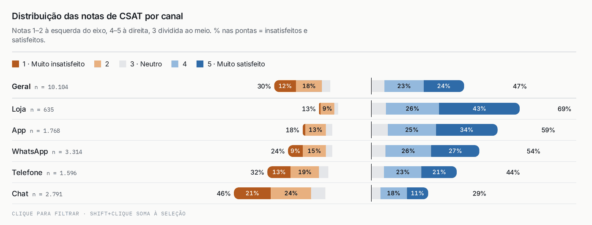
</p>

<p align="center">
  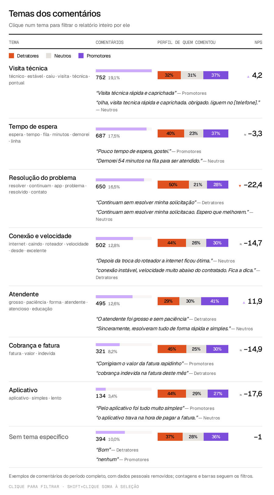
</p>

---

## Temas e Personalização

Todo o visual vem de temas JSON ([`TEMA.md`](TEMA.md)): layout (`clean` ou `blocks`), fontes (Google Fonts embutidas como WOFF2, arquivo local ou fonte do sistema), cores claro/escuro, paleta segura para daltonismo, cantos, fios, espaçamento, escala tipográfica, hero, movimento e logo. O build valida o contraste WCAG automaticamente.

| Preset | Layout | Estilo |
|---|---|---|
| `neutro` *(padrão)* | `clean` | Neutro e calmo: off-white, cinzas, azul `#1F4E79`, Inter + IBM Plex Mono, cartões de KPI |
| `corporativo` | `blocks` | Hero e faixa de KPIs em azul-marinho, IBM Plex |
| `jornal` | `clean` | Títulos serifados (Newsreader), fundo creme, vermelho como cor principal |
| `noturno` | `blocks` | Fundo escuro, blocos verde-limão, Space Grotesk |
| `destaque` | `blocks` | Hero em amarelo-sol, dados em azul-petróleo, Archivo — ideal para apresentações |

<!--
  =============================================================================
  SLOT DE DEMO 6 — GALERIA DE TEMAS
  Sugestão para a refação visual:
  - Comparativo visual (colagem 2x2 ou lado a lado) dos presets neutro,
    corporativo, jornal, noturno e destaque no mesmo conjunto de dados.
  - Asset atual: docs/tema-corporativo-hero.png
  =============================================================================
-->
<p align="center">
  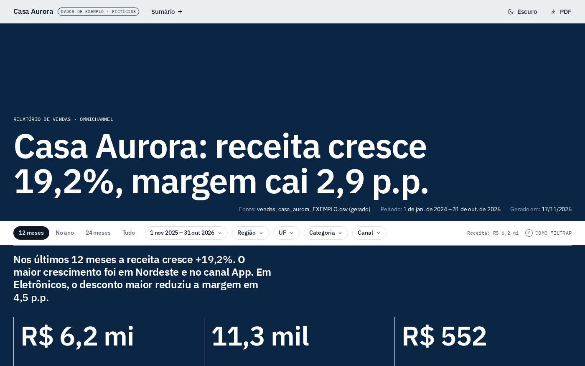
</p>

Sobrescreva qualquer valor inline no spec ou via `--theme`:

```python
spec["theme"] = {
    "primary": "#0B5FFF",
    "accent":  "#7FB2FF",
    "font": "Inter",
    "heading": "Fraunces",       # Google Fonts → embutidas como woff2
    "logo": "logo.svg",
    "brand": "Acme",
    "hero": {"style": "plain"},
    "motion": {"speed": 0.8},
}
```

Para validar um tema sem gerar um relatório completo:

```bash
python tema.py jornal
```

---

## Grid de Layout

Todo o relatório segue um grid único de **12 colunas** (gutter fixo de 32 px), dividido em duas faixas, onde cada bloco ocupa **100% (`full`), 50% (`half`) ou 33% (`third`)**:

- **Cabeçalho em largura total**: título, metadados, barra de filtros fixa, resumo, KPIs e destaques vão de margem a margem.
- **Conteúdo + trilho do menu**: seções, gráficos, tabela e metodologia ficam em uma coluna de largura máxima fixa, com trilho reservado à esquerda onde o menu de capítulos surge suavemente ao rolar (sem pulo de layout).
- **Alinhamento garantido**: cada linha tem uma largura só (`1 full`, `2 halves` ou `3 thirds`). Linhas incompletas são alargadas com aviso no build, títulos lado a lado têm a mesma altura para alinhar eixos e o `verify.py` confere o alinhamento em `1440`, `1280`, `1024` e `390` px.

```python
{"type": "bars", "dim": "canal", "measure": "receita", "width": "half"}  # full (padrão) | half | third
```

<!--
  =============================================================================
  SLOT DE DEMO 7 — SCROLL E GRID DE 12 COLUNAS
  Sugestão para a refação visual:
  - Comparativo topo vs. página rolada (filtros fixos + menu lateral) e overlay
    do grid de 12 colunas.
  - Assets atuais: docs/vendas-topo.png, docs/vendas-rolado-menu.png,
    docs/grid-12-colunas.png
  =============================================================================
-->
<p align="center">
  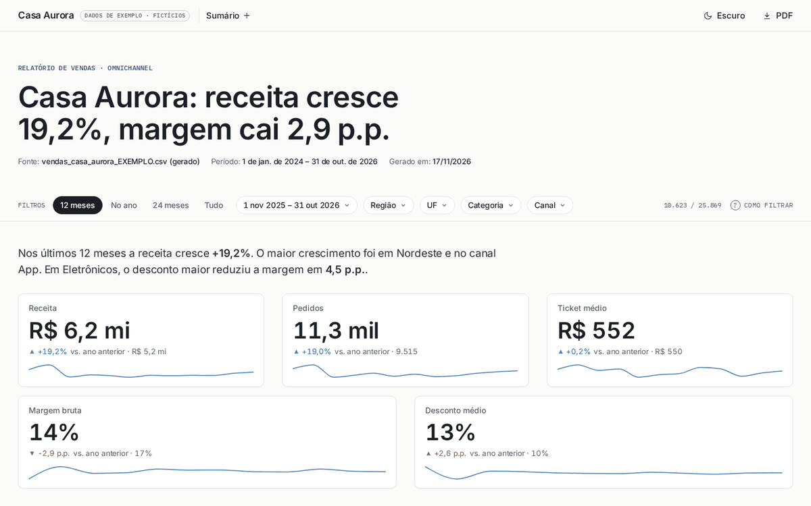
  &nbsp;
  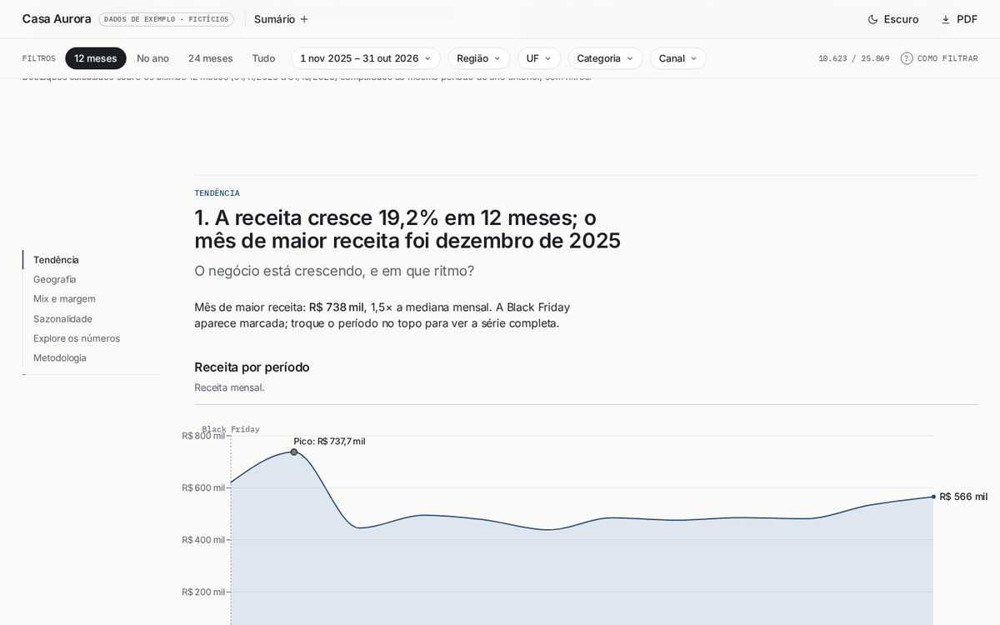
</p>

<p align="center">
  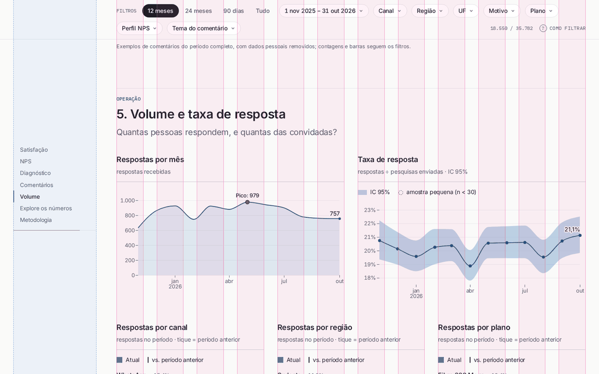
</p>

---

## Uso Direto via CLI / Python

Você também pode usar o kit diretamente sem um agente de IA:

```bash
git clone https://github.com/jpmacieldasilva/interactive-report.git
cd interactive-report
python3 -m venv .venv && source .venv/bin/activate
pip install -r requirements.txt
python -m playwright install chromium

# Exemplos inclusos (os CSVs fictícios são gerados na primeira execução)
python exemplos/vendas/preparar.py               # → exemplos/vendas/relatorio.html
python exemplos/vendas/preparar.py corporativo   # → exemplos/vendas/relatorio-corporativo.html
python exemplos/cx/preparar.py                   # → exemplos/cx/relatorio.html

# Rodar QA automático e gerar screenshots
python verify.py exemplos/cx/relatorio.html --out /tmp/capturas
```

Os HTMLs já gerados estão em `exemplos/` — basta abrir direto no navegador.

### Com os seus dados

1. **Perfil:** `python profile.py dados.xlsx --out perfil.json --clean-out limpo.parquet` (aceita CSV, XLSX, JSON, Parquet e SQLite).
2. **Spec:** Monte as medidas (taxas sempre como razão de somas), pré-agregue e calcule os destaques em Python (copie `exemplos/vendas/preparar.py` ou `exemplos/cx/preparar.py`).
3. **Build:** `python build.py spec.json relatorio.html --theme jornal` (ou `rb.build(spec, "relatorio.html", theme="jornal")`).
4. **Verificação:** `python verify.py relatorio.html --pdf`.

Para importar os módulos por caminho (já que `profile.py` colide com o módulo `profile` da stdlib):

```python
import importlib.util, os, sys

KIT = os.environ.get("INTERACTIVE_REPORT_KIT", "/caminho/para/interactive-report")

def kit(name):
    s = importlib.util.spec_from_file_location("kit_" + name, os.path.join(KIT, f"{name}.py"))
    m = importlib.util.module_from_spec(s)
    sys.modules["kit_" + name] = m
    s.loader.exec_module(m)
    return m

rp, rb, cx = kit("profile"), kit("build"), kit("cx")
```

---

## Estrutura do Repositório

```text
interactive-report/
├── SKILL.md            # Instruções da Agent Skill e referência do spec
├── profile.py          # Leitor universal, limpeza conservadora e perfil de dados
├── build.py            # Validador do spec, encoder colunar e gerador do HTML único
├── verify.py           # Suíte de QA em Chromium headless (layout, a11y, filtros, PDF)
├── cx.py               # Motor de pesquisas (CSAT/CES/NPS, ICs, testes z, drivers, temas)
├── tema.py             # Motor de temas e verificador de contraste WCAG
├── template.html       # Shell do relatório (d3 + Observable Plot + motor de filtro cruzado)
├── TEMA.md             # Documentação completa de temas
├── temas/              # Presets prontos (neutro, corporativo, jornal, noturno, destaque)
├── vendor/             # d3, Observable Plot e fontes OFL em cache para builds offline
├── exemplos/           # Exemplos completos de vendas e pesquisa CX (dados fictícios)
└── docs/               # Capturas de tela e assets de demonstração
```

---

## Limitações e Privacidade

- **Todos os dados vão para o navegador:** Agregue ou remova dados pessoais e segredos antes de gerar o arquivo (nas pesquisas, o texto completo dos comentários nunca é embutido).
- **Volume:** O filtro no navegador é confortável até ~150–200 mil linhas na tabela fato. Acima disso, agregue mais (ex.: dia → semana).
- **Destaques estáticos:** Os textos de destaque descrevem a visão padrão sem filtros; KPIs e gráficos atualizam ao vivo.
- **Temas de comentários e mascaramento de PII:** Temas offline atribuem um tema por comentário pelos termos mais característicos, e o mascaramento de PII é heurístico — revise as citações antes de compartilhar.
- **Premissas estatísticas:** Drivers mostram associação, não causa; os testes assumem respostas independentes.
- **Google Fonts:** Precisam de internet só no primeiro build (ficam em cache em `vendor/fonts-cache/`).

---

## Licenças

Código sob [MIT](LICENSE) © 2026 João Paulo da Silva.  
Os componentes de terceiros embutidos — d3 e Observable Plot (ISC) e as fontes Geist, IBM Plex, Inter, JetBrains Mono, Montserrat, Newsreader e Space Grotesk (SIL OFL 1.1) — mantêm suas respectivas licenças. Veja [NOTICE.md](NOTICE.md). Todos os dados em `exemplos/` são **fictícios**.
